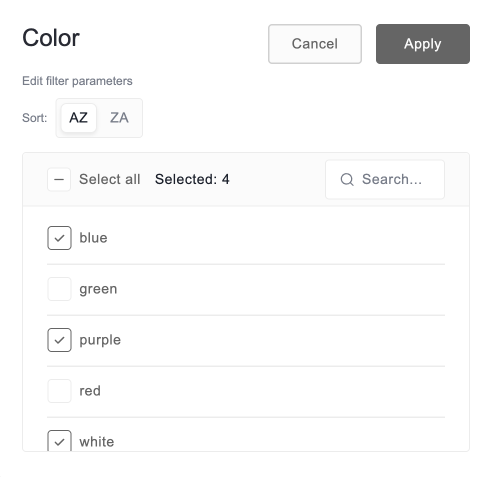

# Renaming field captions

By default, a field's caption is its name in the data source—for example, `order_date`. This guide describes how you can rename field captions that are displayed everywhere the same data is shown.

Note that a caption can't be empty. To bring back the original caption, reset it instead of clearing the input field.

## Rename a field

### In the filter view

**Step 1.** Open the filter view by selecting the field’s name.

**Step 2.** At the top of the filter view, edit the caption in the input field:

**Step 3.** Select **Apply**.

### In the field list (flat table only)

In the flat table, you can rename a field through the field list:

**Step 1.** Open the field list.

**Step 2.** Find the field you want to rename and select . As a result, the **Edit field** dialog will appear.

**Step 3.** In the dialog, enter a new name in the **Caption** field.

**Step 4.** Select **Apply** in the **Edit field** dialog.

**Step 5.** Select **Apply** in the field list.

## Rename a measure

You can set a custom caption for measures in the pivot table through the field list:

**Step 1.** Open the field list.

**Step 2.** In the **Values** box, find the measure you want to rename and select .

**Step 3.** In the **Edit measure** dialog, enter a new name in the **Caption** field.

**Step 4.** Select **Apply** in the **Edit measure** dialog.

**Step 5.** Select **Apply** in the field list.

The **Edit measure** dialog also lets you change the /user-guide/aggregations for the measure.

## Reset a caption

To bring back the original caption of a field or a measure:

**Step 1.** Open the field list.

**Step 2.** Select  next to the field or measure to open the **Edit field** or **Edit measure** dialog.

**Step 3.** Select  in the **Caption** field.

**Step 4.** Select **Apply** in the dialog.

**Step 5.** Select **Apply** in the field list.
