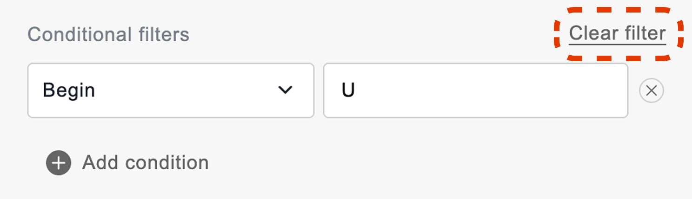

# Filtering by condition

The conditional filter allows filtering members of a field based on the specified condition. You can filter by condition in both the pivot and the flat table.

Note that the conditional filters are available only for the fields that contain numbers or text.

You can apply a conditional filter and a member filter to the same field.

## Available conditions

The conditions you can choose from depend on the kind of data the field holds.

### Numbers

| Condition | What it shows |
| --- | --- |
| **Equal** | Numbers equal to the value you specify. |
| **Not equal** | Numbers not equal to the value you specify. |
| **Greater** | Numbers greater than the value you specify. |
| **Greater or equal** | Numbers greater than or equal to the value you specify. |
| **Less** | Numbers less than the value you specify. |
| **Less or equal** | Numbers less than or equal to the value you specify. |
| **Between** | Numbers inside the range you specify, including the range boundaries. |
| **Not between** | Numbers outside the range you specify, excluding the range boundaries. |

### Text

| Condition | What it shows |
| --- | --- |
| **Equal** | Text equal to the value you specify. |
| **Not equal** | Text not equal to the value you specify. |
| **Begin** | Text that begins with the value you specify. |
| **Not begin** | Text that doesn't begin with the value you specify. |
| **End** | Text that ends with the value you specify. |
| **Not end** | Text that doesn't end with the value you specify. |
| **Contain** | Text that contains the value you specify. |
| **Not contain** | Text that doesn't contain the value you specify. |

## Configure the filter

**Step 1.** Open the filter view by selecting the field’s name.

**Step 2.** Select **Add condition**. As a result, the **Conditional filters** section will appear.

**Step 3.** Choose a condition from the dropdown menu and enter a value in the input field. The **Between** and **Not between** conditions take two values that define the range.

Check out an example of a filter configuration:

**Step 4.** *(Optional)* To filter by more than one condition, select **Add condition** again and configure the next one.

**Step 5.** Once the filter is configured, select **Apply** to save your configuration.

## Clear the filter

To clear a specific conditional filter, select  next to the necessary filter configuration:

To clear all conditional filters at once, select **Clear filter**:

Then, select **Apply** to save your changes.