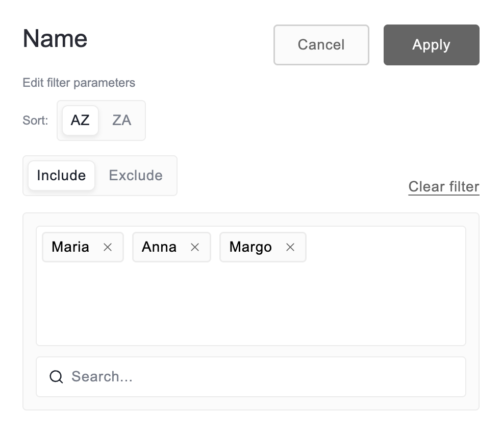
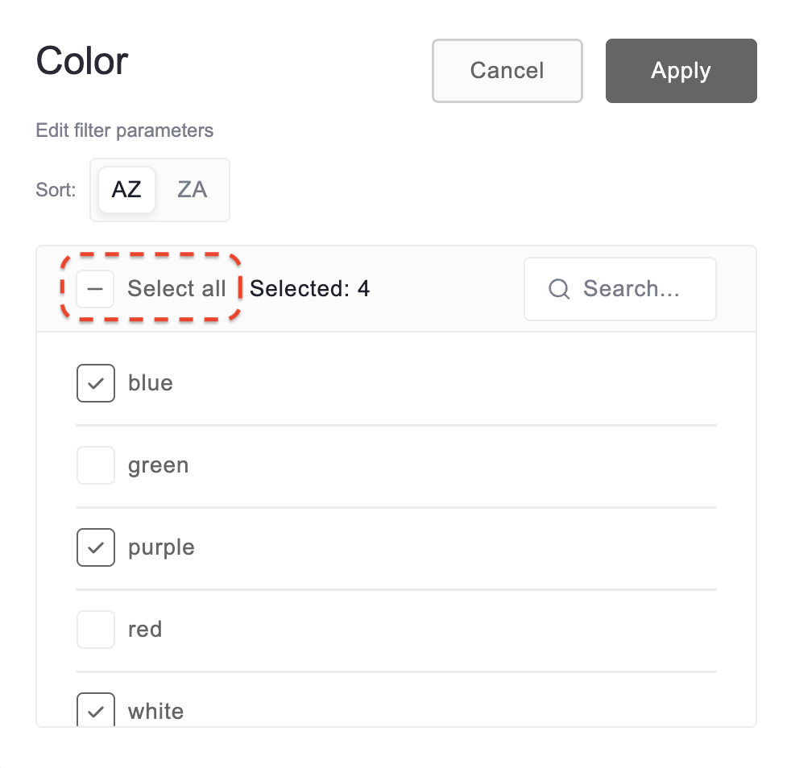
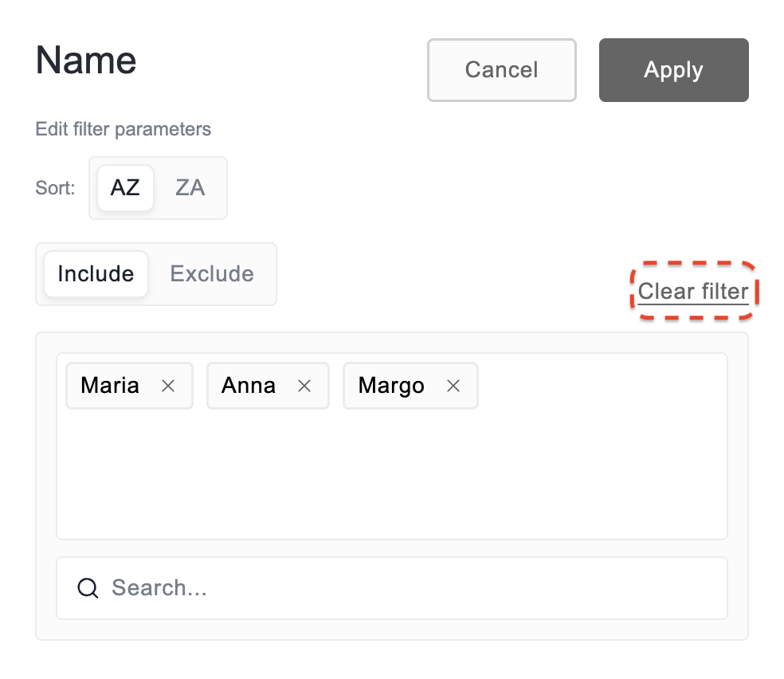

# Filtering by members

The member filter defines which specific members of a field are displayed on the grid. You can filter by members in both the pivot and the flat table.

Filtering works in one of two directions:

- **Include**—only the members you select are shown.

- **Exclude**—the members you select are hidden.

You can apply a member filter and a conditional filter to the same field.

## Configure the filter

**Step 1.** Open the filter view by selecting the field’s name.

**Step 2.** Select the members you need. The filter view looks different depending on how many members the field has.

If the field contains fewer than 256 members, use the checkboxes to select the members that should be displayed. You can also select several members at once using the search box. The following screenshot shows an example of a filter configuration:

If the field contains 256 members or more, they aren't listed as checkboxes. Select **Include** or **Exclude**, then use the search box to find the members you need. Each member you pick is added to the box above the search, and you can remove it from there by selecting **×**:

**Step 3.** Once the filter is configured, select the **Apply** button to save your configuration.

### Select several members at once

The search box in the filter view can be used to select or deselect multiple members at once.

Note that the search box is hidden if the field contains fewer than 6 members.

Use the search depending on how you want to modify the selection filter.

#### Select a group of member

**Step 1.** Open the filter view.

**Step 2.** *(Optional)* To start from an empty selection, select the **Select all** checkbox until all members are deselected.

**Step 3.** In the search box, enter a search term to find the members you want to include. For example, to include `Poland` and `Switzerland` in the selection, enter `land` in the search box.

**Step 4.** Select the **Select all results** checkbox until all members that match the search term are selected. If there are members you want to exclude, deselect them individually.

**Step 5.** *(Optional)* To include more members, select **×** in the search box and return to **Step 3**.

**Step 6.** Select **Apply** to see the result.

#### Deselect a group of members

**Step 1.** Open the filter view.

**Step 2.** *(Optional)* To start from a full selection, select the **Select all** checkbox until all members are selected.

**Step 3.** In the search box, enter a search term to find the members you want to exclude. For example, to exclude `Poland` and `Switzerland` from the selection, enter `land` in the search box.

**Step 4.** Select the **Select all results** checkbox until all members that match the search term are deselected. If there are members you want to include, select them individually.

**Step 5.** *(Optional)* To exclude more members, select **×** in the search box and return to **Step 3**.

**Step 6.** Select **Apply** to see the result.

## Clear the filter

**Step 1.** Open the filter view by selecting the field’s name.

**Step 2.** If the field contains fewer than 256 members, select the **Select all** checkbox to choose all members:

If the field contains 256 members or more, select **Clear filter**:

**Step 3.** Select the **Apply** button to save your changes.