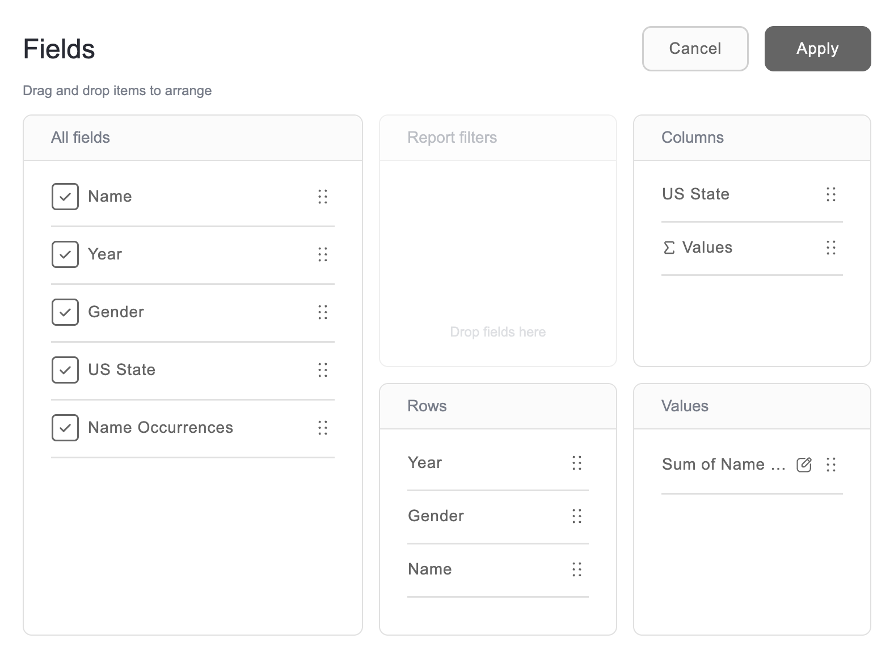

# Field list

A field list is used to define which fields are displayed on the grid and how they're arranged.

This guide describes how to open the field list and what you can do in it.

## Open the field list

Select the **Fields** tab on the toolbar. As a result, the field list will appear as a dialog:

Note that your application can also display the field list as a panel next to the grid. In this case, the field list is always visible.

## The field list in the pivot table

The field list for the pivot table contains the following boxes:

- **All fields**—all the fields available in your data. Select the checkbox next to a field to display it on the grid.
- **Rows** and **Columns**—the fields that form the structure of the pivot table.
- **Values**—the measures whose aggregated values are shown in the cells. The **Σ Values** item in the **Rows** or **Columns** box defines where these measures are displayed.
- **Report filters**—the fields you want to filter by without showing them on the grid. See report filters.

Drag fields between the boxes to arrange them, and drag them up or down within a box to change their order. To learn more, see how to choose fields to show.

To open the **Edit measure** dialog for a measure in the **Values** box, select  next to it. There you can change the measure's aggregation function and caption.

## The field list in the flat table

The field list for the flat table contains a list of all the fields available in your data. Select the checkbox next to a field to display it as a column, or use the **Select all** checkbox to display all the fields at once.

Drag a field up or down to change the order of the columns.

To open the **Edit field** dialog, select  next to a field. There you can change the field's aggregation function, caption, and total visibility.

## Find a field

If your data contains many fields, use the search box in the field list to find a field by its name.

## Apply or discard your changes

Your changes aren't reflected on the grid until you select **Apply** in the field list.

To close the field list without applying the changes, select **Cancel**.
