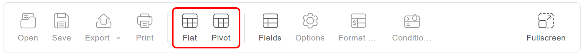

# Grid layouts

Flexmonster shows your data in one of two layouts: the pivot table or the flat table.

This guide explains how the layouts differ, how to switch between them, and how to manage totals in the flat table.

## Pivot table

The pivot table lets you analyze data from different angles by grouping fields in rows and columns. The fields in the **Rows** and **Columns** areas form the structure of the table, and the cells show aggregated values for the fields placed in the **Values** area. The pivot table also shows totals and grand totals.

Use the pivot table when you need summarized data—for example, sales per country per year.

To define which fields form the structure, see how to choose fields to show.

## Flat table

The flat table shows data in a raw, non-aggregated form. Each record is displayed as a separate row, and each field is displayed as a separate column. Totals can be shown per column.

Use the flat table when you need to look through the individual records instead of summaries.

## Switch between the layouts

If both layouts are available in your application, the **Flat** and **Pivot** tabs are displayed on the toolbar. Select the tab you need to change the layout:

By default, the pivot layout is displayed.

## Manage totals in the flat table

In the flat table, you can show or hide the total for each field separately:

**Step 1.** Open the field list.

**Step 2.** Find the field you need and select . As a result, the **Edit field** dialog will appear.

**Step 3.** Turn the **Total** toggle on or off, depending on your needs.

**Step 4.** Select **Apply** in the **Edit field** dialog.

**Step 5.** Select **Apply** in the field list.
